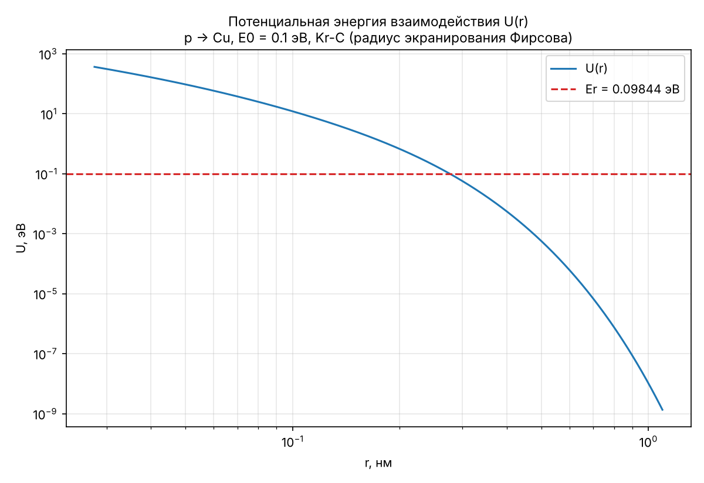
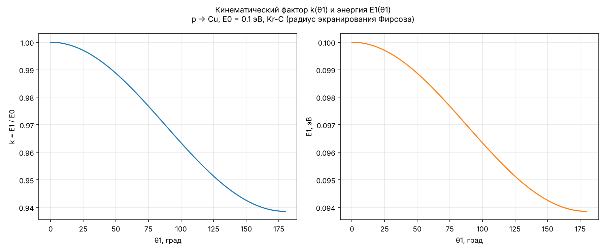
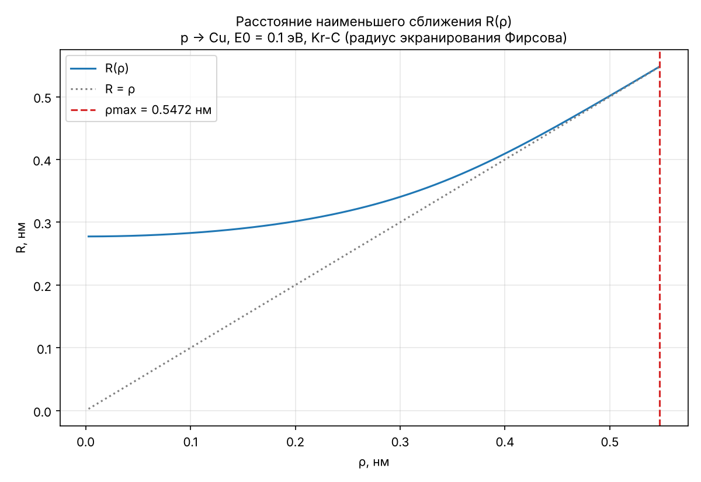
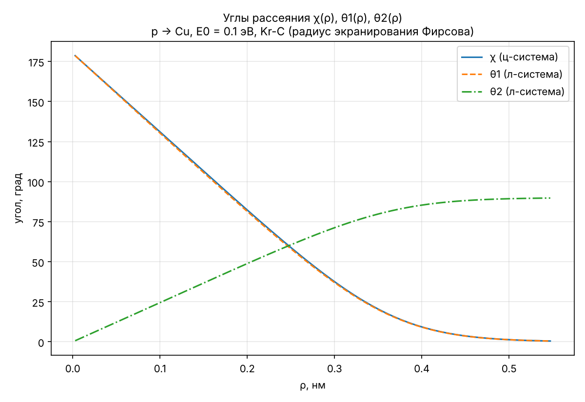
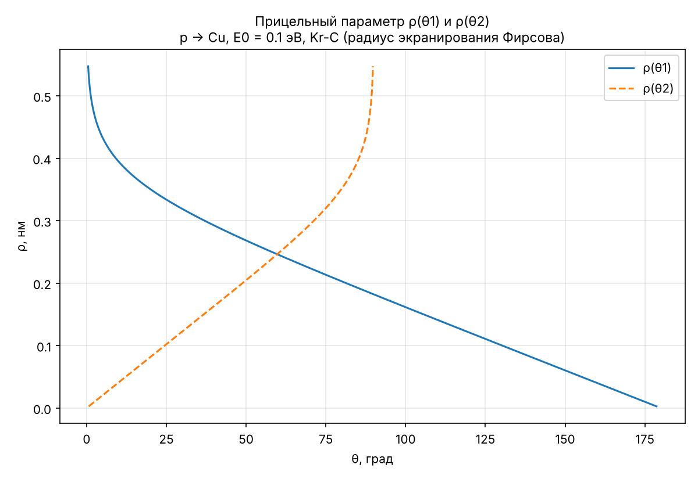
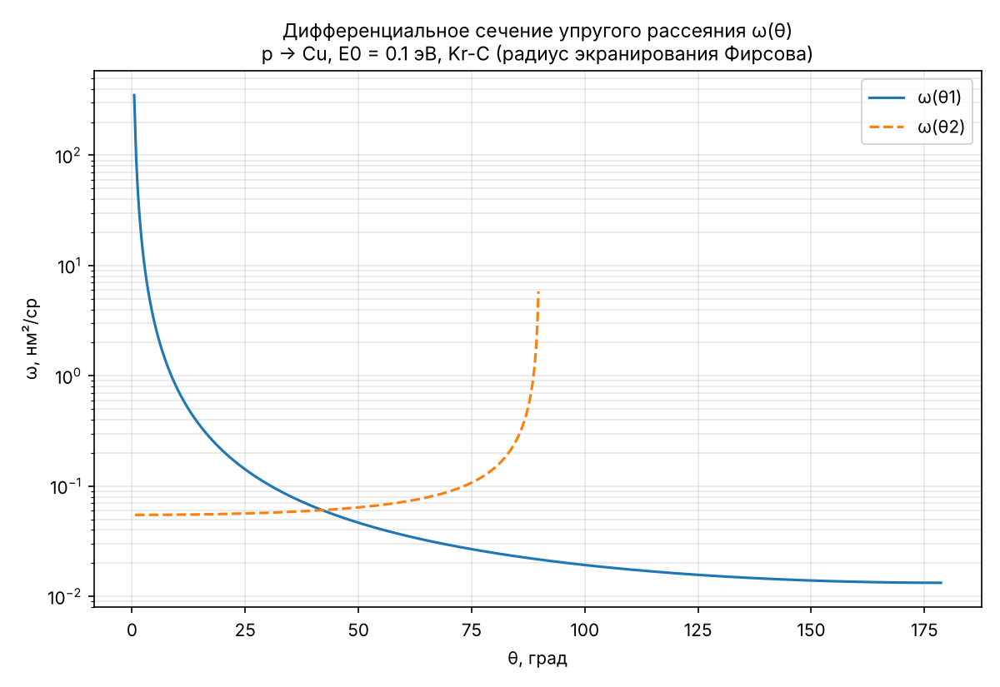

# Практическое задание № 1. Решение задачи двух тел — вариант 4

**Цель работы:** определение зависимости угла рассеяния частицы от прицельного
параметра при столкновении двух частиц и зависимости дифференциального сечения
упругого рассеяния от углов рассеяния.

## Индивидуальное задание (вариант 4: А = 3, Б = 1)

| Параметр | Значение |
|---|---|
| Потенциал | Kr-C: F(x) = 0,190945·e^(−0,278544x) + 0,473674·e^(−0,637174x) + 0,335381·e^(−1,919249x) |
| Радиус экранирования | Фирсова: a = 0,8853·a_B·(Z1^1/2 + Z2^1/2)^(−2/3) ≈ 0,01361 нм |
| E0 | 0,1 эВ (Er = E0·m2/(m1+m2) ≈ 0,0984 эВ) |
| Налетающая частица | p (Z1 = 1, m1 = 1,00728 а.е.м.) |
| Покоящаяся частица | Cu (Z2 = 29, m2 = 63,546 а.е.м.) |

## Запуск

```bash
pip install -r requirements.txt
python main.py                # вариант 4
python main.py --variant 10   # любой другой вариант из таблицы (1–24)
python -m unittest discover   # тестовые расчёты
```

Графики и таблица `scattering_table.csv` (ρ, R, χ, θ1, θ2) сохраняются
в `results/variant_04/`.

## Структура программы (ООП)

| Модуль | Классы | Назначение |
|---|---|---|
| `two_body/particles.py` | `Particle`, `ParticleCatalog` | частицы (Z, масса) и их справочник |
| `two_body/screening.py` | `ScreeningFunction`; `ScreeningLength` → `ThomasFermiScreeningLength` → `FirsovScreeningLength`, `LindhardScharffScreeningLength`; `ZBLScreeningLength` | функции экранирования F(r/a) (табл. 1) и длины экранирования a(Z1, Z2) |
| `two_body/potentials.py` | `InteractionPotential` → `CoulombPotential` → `ScreenedCoulombPotential` | потенциалы (6), (7) |
| `two_body/kinematics.py` | `BinaryCollision` | Er, кинематический фактор k(θ1) (15), E1, углы θ1, θ2 по χ (17) |
| `two_body/scattering.py` | `RadialFunction`, `ClosestApproachSolver`, `ImpactParameterGrid`, `GaussMehlerScatteringAngle` | g(r), R(ρ), сетка ρ и ρmax, угол χ(ρ) |
| `two_body/cross_section.py` | `DifferentialCrossSection` | ω(θ) = ρ/sin θ·\|dρ/dθ\| (19) |
| `two_body/variants.py` | `PotentialOption`, `CollisionOption`, `Variant` | таблицы вариантов и сборка объектов задачи |
| `two_body/experiment.py` | `TwoBodyScatteringExperiment`, `ScatteringResults` | выполнение пп. 1–4 и хранение результатов |
| `two_body/plotting.py` | `ResultsPlotter` | построение графиков |
| `main.py` | `Application` | консольный запуск |

## Алгоритм

1. **Кинематический фактор.** U(r) = Z1Z2e²/r·F(r/a), e² = 1,44 эВ·нм.
   k(θ1) = (m1/(m1+m2))²·(cos θ1 + √((m2/m1)² − sin²θ1))², E1 = k·E0.
2. **Сетка прицельных параметров.** Уравнение g(R) = 1 − U(R)/Er − ρ²/R² = 0
   решается методом деления отрезка пополам (g(r) монотонно возрастает,
   корень единственный). ρmax — наименьший ρ, при котором |1 − R/ρ| < 10⁻³
   (тоже находится делением пополам). Сетка: ρ ∈ [ρmax/200, ρmax], Δρ = ρmax/200.
3. **Угол рассеяния.** Квадратура Гаусса–Мелера (N = 100):
   χ = π − 2(ρ/R)(π/N)·Σ ξn·ξ(N−n+1) / √g(R/ξn²), ξn = cos((2n−1)π/(4N)).
   Подстановка r = R/ξ² устраняет особенность подынтегральной функции в точке r = R.
   Углы в л-системе: tg θ1 = m2 sin χ/(m1 + m2 cos χ), θ2 = (π − χ)/2.
4. **Сечения.** Зависимости ρ(θ1), ρ(θ2) — обращение табличных θ(ρ);
   производная dρ/dθ находится численно на неравномерной сетке.

## Тестовые расчёты

`tests/test_two_body.py` сравнивает численные результаты с аналитическими:

* кулоновский потенциал: R(ρ) = b/2 + √(b²/4 + ρ²) и χ = 2·arctg(b/(2ρ)),
  b = Z1Z2e²/Er (погрешность χ < 10⁻⁴ рад при N = 100);
* сечение Резерфорда ω(χ) = (b/4)²/sin⁴(χ/2);
* предельные значения k(0) = 1, k(π) = ((m2−m1)/(m1+m2))², закон сохранения энергии
  k1 + k2 = 1;
* нормировка функций экранирования F(0) = 1 и длины экранирования.

## Результаты (вариант 4)

* Расстояние наименьшего сближения при лобовом ударе R(0) ≈ 0,2774 нм ≈ 20a.
* ρmax ≈ 0,5472 нм, Δρ ≈ 0,002736 нм.

| ρ, нм | R, нм | χ, ° | θ1, ° | θ2, ° |
|---:|---:|---:|---:|---:|
| 0,002736 | 0,277411 | 178,66 | 178,64 | 0,67 |
| 0,109443 | 0,284081 | 126,37 | 125,63 | 26,81 |
| 0,218887 | 0,307065 | 73,28 | 72,41 | 53,36 |
| 0,328330 | 0,356756 | 27,18 | 26,77 | 76,41 |
| 0,437774 | 0,442515 | 4,65 | 4,57 | 87,68 |
| 0,547217 | 0,547764 | 0,49 | 0,48 | 89,75 |








## Анализ

* Протон намного легче ядра меди (m2/m1 ≈ 63), поэтому θ1 ≈ χ, а кинематический
  фактор меняется слабо: от 1 при θ1 = 0 до ≈ 0,939 при θ1 = 180°; энергия
  рассеянного протона E1 лежит в диапазоне 0,094–0,1 эВ.
* При E0 = 0,1 эВ частица останавливается далеко от ядра (R ≈ 20a), где
  экранированный потенциал убывает почти экспоненциально. Поэтому R(ρ) при малых ρ
  почти не зависит от ρ, а рассеяние близко к рассеянию на твёрдой сфере:
  χ(ρ) убывает почти линейно, ω(θ1) при больших углах слабо зависит от угла.
* Уже при ρ > 0,45 нм потенциал перестаёт влиять на движение (R → ρ, χ → 0),
  поэтому сечение ω(θ1) резко растёт при θ1 → 0, а ω(θ2) — при θ2 → 90°.
* Тесты на кулоновском потенциале показывают, что квадратура Гаусса–Мелера
  с N = 100 узлами даёт угол рассеяния с погрешностью менее 10⁻⁴ рад.

> Примечание: в табл. 1 пособия коэффициенты ZBL дают Σc_i = 0,945 ≠ 1, поэтому
> в программе для ZBL используются стандартные коэффициенты Циглера–Бирзака–Литтмарка
> (на вариант 4 это не влияет).
